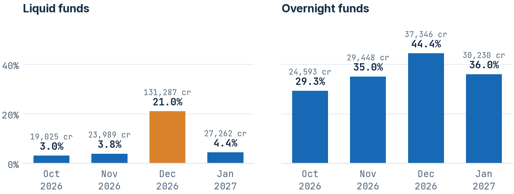
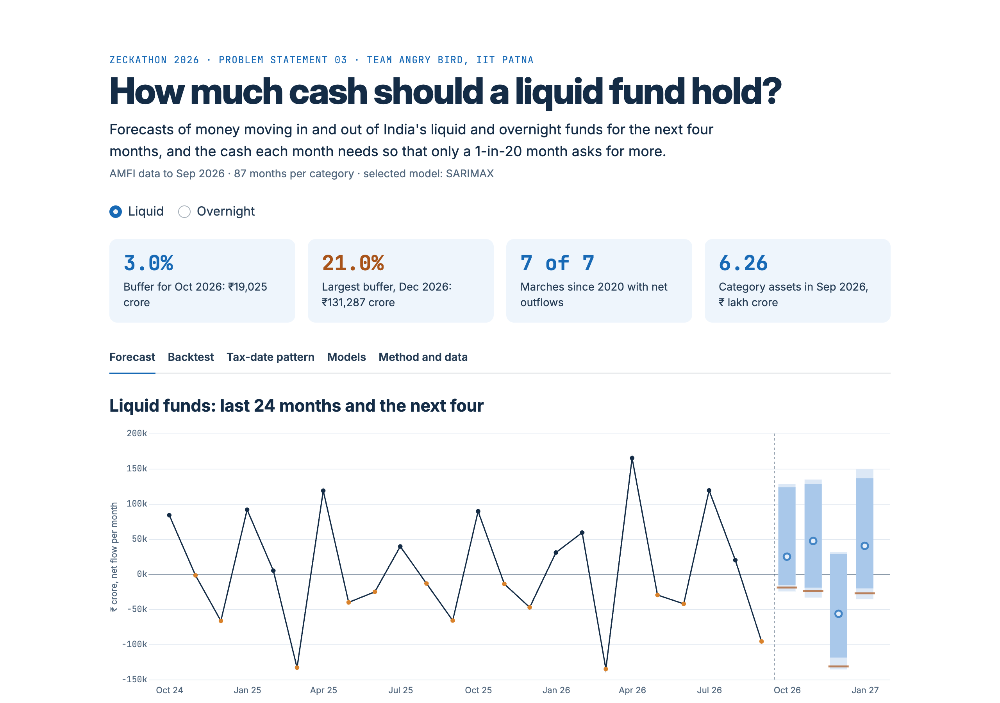
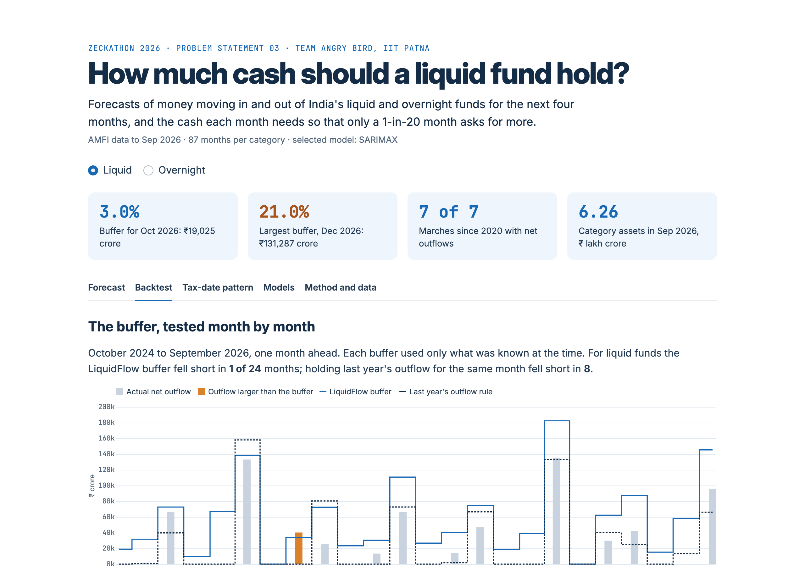

# LiquidFlow

**How much cash should a liquid fund hold?** LiquidFlow forecasts monthly net flows for India's liquid and overnight mutual fund categories, puts an 80% and 95% range around each forecast, and turns the bottom of that range into a cash buffer. The buffer is backtested against the rule named in the brief: hold last year's outflow for the same month.

Zeckathon 2026, Problem Statement 03. Team **Angry Bird**, IIT Patna: Jayant Raj, Rohan Kumar Singh, Harshit Kumar and Viraj Singh.

Live dashboard: [liquidflow.streamlit.app](https://liquidflow.streamlit.app)



## The answer

Liquid funds should keep about 3 to 4% of assets ready to pay out in a normal month and about 21% going into December. March is the hardest month of the year: in each of the last three, 23% to 31% of the category's money left.



| Month | Liquid: central forecast | Liquid: buffer | Overnight: central forecast | Overnight: buffer |
| --- | ---: | ---: | ---: | ---: |
| Oct 2026 | +24,824 | 19,025 (3.0%) | +5,176 | 24,593 (29.3%) |
| Nov 2026 | +47,097 | 23,989 (3.8%) | +5,734 | 29,448 (35.0%) |
| Dec 2026 | −56,397 | 131,287 (21.0%) | −1,007 | 37,346 (44.4%) |
| Jan 2027 | +40,212 | 27,262 (4.4%) | +8,057 | 30,230 (36.0%) |

₹ crore. Positive is a net inflow. The buffer is the 5th percentile of the forecast net flow, turned into an outflow and shown with its share of September 2026 assets. October is a nowcast, because AMFI publishes October figures in early November. Buffers are separate for each month and should not be added together.

**Backtest, October 2024 to September 2026 (48 category-months, one month ahead):**



| Rule | Months short | Average buffer | Cost under the brief's formula (₹ cr) |
| --- | ---: | ---: | ---: |
| Last year's same-month outflow | 18 | 5.9% of assets | 895,707 |
| LiquidFlow buffer | 4 | 18.6% of assets | 111,863 |
| Seasonal-naive 95% band | 2 | 22.6% of assets | 51,375 |

LiquidFlow cuts the cost by 87.5% against last year's rule. A plain seasonal 95% band does better still, so most of the gain comes from sizing cash to the downside of a forecast range rather than from the choice of model.

## What we found

- **Advance-tax dates drive the outflows.** Liquid funds have seen a net outflow in 7 of 7 Marches, 8 of 8 Septembers, 6 of 7 Junes and 6 of 7 Decembers since 2019. Removing calendar inputs worsened the Ridge model's error by 1.14 points of assets, more than any other input group.
- **Rupee accuracy and percentage accuracy disagree.** SARIMAX, chosen on the selection year, cut MAPE by 41% against seasonal naive on the test years but had a slightly higher error in rupees (13.3% of assets against 12.4%). Ridge and CatBoost did not beat the seasonal methods either.
- **The ranges are somewhat narrow.** The 95% range caught 93% of liquid-fund outcomes but only 78% for overnight funds. Treat the overnight buffer as a minimum.

The full write-up is in [`report/LiquidFlow_Team_Angry_Bird_PS03.pdf`](report/LiquidFlow_Team_Angry_Bird_PS03.pdf). Method details are in [`docs/METHODOLOGY.md`](docs/METHODOLOGY.md).

## Run it

Python 3.11 or later (tested on 3.13, Linux). No GPU, API keys or paid data.

```bash
python -m venv .venv
source .venv/bin/activate          # Windows: .venv\Scripts\activate
pip install -r requirements.lock.txt
pip install -e . --no-deps
streamlit run app.py               # dashboard at http://localhost:8501
```

The repository ships with the data snapshot and all results, so the dashboard opens straight away and works offline.

To rerun everything from the saved source data:

```bash
make all
```

This checks every raw source file against its recorded SHA-256, refits all models at every forecast origin, recomputes the metrics, cross-checks the headline numbers independently, rebuilds the figures and the PDF, and runs the tests. It takes about a minute and a half on a laptop CPU. A rerun reproduces `artifacts/raw_predictions.csv` byte for byte.

| Command | What it does |
| --- | --- |
| `make install` | Install the pinned dependencies and the package |
| `make audit` | Verify raw AMFI and RBI files against their hashes |
| `make analysis` | Rolling refits, intervals, scoring, model selection and buffers |
| `make verify` | Recompute MAE, coverage and buffer cost from the CSVs, without the metric code |
| `make report` | Rebuild the figures and the PDF |
| `make test` | Unit tests, saved-model reload tests and a dashboard smoke test |
| `make app` | Start the dashboard |
| `make data` | Download fresh AMFI and RBI data (needs internet) |

## Repository layout

```
app.py                  Streamlit dashboard
protocol.json           Fixed experiment settings, written before any model was fitted
liquidflow/             Package: data parsing, features, models, evaluation
  data.py               AMFI download, parsing and accounting checks
  macro.py              RBI call rate, Nifty 50 average and liquidity operations
  features.py           Direct multi-horizon feature rows
  forecast.py           Candidate models and the expanding-window refit loop
  evaluation.py         Intervals, metrics, model selection and buffer costs
scripts/                Command-line steps used by the Makefile
data/raw/               Source files exactly as downloaded
data/processed/         Parsed monthly series with source URLs and hashes
artifacts/              Forecasts, backtest predictions, metrics, fitted models, figures
report/                 Final PDF report
docs/METHODOLOGY.md     Method, evaluation design and limitations
tests/                  pytest suite
```

Key output files:

- `artifacts/forecasts.csv`: the selected model's forecasts for October 2026 to January 2027, both categories, with all quantiles and buffers.
- `artifacts/baseline_forecasts.csv`: the same table from seasonal naive, for comparison.
- `artifacts/predictions.csv`: every backtest forecast from every model at every origin.
- `artifacts/metrics_overall.csv` and `metrics_by_category_horizon.csv`: scores on the selection year and the test years.
- `artifacts/policy_months.csv` and `policy_sanity_checks.csv`: month-by-month buffers and costs for each rule.
- `artifacts/evidence.json`: one file with the protocol, selection, scores and data summary.

In the forecast files `q025`/`q975` bound the 95% range, `q100`/`q900` the 80% range, `point` is the central forecast and `q050` is the 5th percentile used for the buffer.

## Data

| Source | Coverage | Used for |
| --- | --- | --- |
| [AMFI monthly reports](https://www.amfiindia.com/research-information/amfi-monthly) | Jul 2019 to Sep 2026 | Net flows and assets, liquid and overnight |
| [RBI Handbook of Statistics](https://www.rbi.org.in/scripts/AnnualPublications.aspx?head=Handbook%20of%20Statistics%20on%20Indian%20Economy&lang=en), Tables 174 and 182 | Apr 2018 to Jun 2026 | Call-money rate, Nifty 50 monthly average |
| [RBI Bulletin](https://www.rbi.org.in/Scripts/BS_ViewBulletin.aspx), liquidity operations | Jul 2019 to Jul 2026 | Banking-liquidity input |
| Income Tax Department | Advance-tax schedule | Calendar inputs |

All data is public and aggregate. See [`data/README.md`](data/README.md) for provenance and terms.

## Limits

These are category-level monthly forecasts. A single fund planning for 15 March also needs its own daily redemptions, how concentrated its investors are and when its holdings mature. Redemptions are paid on the morning of T+1 while TREPS and reverse-repo money comes back in the evening, so intraday timing matters too. The 20% eligible-liquid-assets rule for liquid funds is not a 20% cash requirement, and this project does not check scheme holdings for regulatory compliance.

## Team

Team Angry Bird, Indian Institute of Technology Patna: Jayant Raj, Rohan Kumar Singh, Harshit Kumar and Viraj Singh.

Fonts: Inter and JetBrains Mono, both under the SIL Open Font License (`assets/fonts/`).
